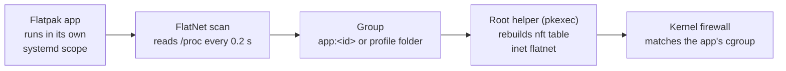

# FlatNet

**Per-app internet control and throwaway profiles for Flatpak apps on Linux: one click, no restart, one Python file.**


> [!NOTE]
> **Cut has been tested live; LAN only and the data counters not yet.** Cut stopped a running Chrome profile's internet on CachyOS. Run [SETUP.md, Step 7](docs/SETUP.md#step-7-test-that-the-firewall-works) once on your PC before relying on a block. Test results and bug reports are welcome in Issues.

## What is FlatNet?

Flatpak lets you turn an app's network on or off, but only when the app starts, and only for the whole app. FlatNet adds two things:

1. **Internet control for any running Flatpak app.** Switch an app between Online, LAN only and Cut while it runs, without restarting it. The block covers every copy of the app, including copies started later.
2. **Throwaway profiles.** Open Chrome, Firefox, Falkon or LibreOffice with a fresh, separate profile. The profile is deleted when the app closes, unless you click **Keep (save)**.

**FlatNet shows only what is really applied.** The Network column reads the live firewall state, not what you last clicked. If a firewall change fails, nothing changes and the error is shown.

| Mode | Internet | Home network | Switch while running | How |
|---|---|---|---|---|
| Online | Yes | Yes | Yes | No rule |
| LAN only | No | Yes | Yes | Firewall rule: private addresses only |
| Cut | No | No | Yes | Firewall rule: all outgoing traffic blocked |
| Offline (sandbox) | No | No | No, restart needed | `flatpak run --unshare=network`, no leak from the first second |

## Features

- **Works on every running Flatpak app**, not only the ones FlatNet started
- **Blocks follow the group:** cut Discord once and every Discord copy stays cut while FlatNet is open
- **Throwaway profiles** in `profiles/`, private to your user (permission `700`), auto-deleted when closed
- **Keep (save)** turns a temp profile into a named, permanent one
- **Default network per app** for new profiles
- **Sent and Received counters** per running app
- **Always offline on/off:** a permanent Flatpak override for one app
- **One password per session:** a small root helper is started once with `pkexec`; nothing else runs as root
- **Blocks survive a restart of FlatNet:** they are saved and re-applied on the next start
- **No hardcoded paths:** found on the first start on each machine and kept in a private cache outside the project, so the repo is safe to publish

## How it works



Each Flatpak run gets its own cgroup scope. FlatNet points nftables rules at that scope, so only that app is affected. The whole table is rebuilt on each change, so it never holds stale rules. Profiles work by redirecting the app's config, data, cache and state folders into the profile's `data/` folder.

## Quick start

Requirements: Linux with systemd and cgroup v2, Python 3.6 or newer with Tkinter, Flatpak, nftables, pkexec and a polkit agent (KDE and GNOME have one).

```sh
git clone https://github.com/Muzasio/flat-net.git
cd flat-net
python3 flatnet.py                  # open the window
python3 flatnet.py --install-menu   # optional: add FlatNet to your app menu
```

No path is written in the code or the repo. The first start on each machine finds FlatNet's folder and saves it in a private cache outside the project (`~/.cache/flatnet/`). Later starts only read it. If you move the folder, the next start updates the cache, the saved blocks and the menu entry.

Check and install the requirements, and add FlatNet to your app menu: [SETUP.md](docs/SETUP.md).

Remove every FlatNet rule at once (all apps get internet back):

```sh
sudo nft delete table inet flatnet
```

## Adding an app for profiles

Internet control needs no setup. Throwaway profiles need one line in `apps.json`:

```json
"Chrome": {"id": "com.google.Chrome", "args": ["--no-first-run", "--no-default-browser-check"]}
```

`id` is the Flatpak app ID (`flatpak list --app`). In `args`, `{dir}` becomes the profile folder and `{url}` the same folder as a `file://` address. Restart FlatNet after editing.

## Known limits

- **Flatpak apps only.** Native apps have no scope of their own, so they cannot be targeted.
- **LAN only and Cut start about 0.2 s after the app appears.** Use Offline (sandbox) for no gap.
- **FlatNet must stay open** to block copies started later. Blocks already applied stay on after it closes.
- **LAN only allows `127.0.0.0/8`**, so the local DNS service and local proxies or VPNs still work.
- **Desktop requests are not blocked.** A cut app can still ask the desktop to open a link over D-Bus.
- **Data counters reset** when FlatNet restarts.

The full list, with fixes: [TROUBLESHOOTING.md](docs/TROUBLESHOOTING.md).

## Status and roadmap

FlatNet is usable today for profiles, Cut and Offline (sandbox). LAN only and the data counters still need their first live test.

**Done**
- Internet control (Online, LAN only, Cut) for any running Flatpak app, with blocks per app or per profile
- Throwaway and kept profiles for Chrome, Firefox, Falkon and LibreOffice, extendable through `apps.json`
- Offline (sandbox) mode, Always offline override, default network per app, data counters
- Paths found at runtime once per machine, menu entry generated by `--install-menu`
- Full documentation: user guide, setup, troubleshooting and the build journey

**Tested** on CachyOS (Arch based), kernel 7.2.7, Python 3.14.7, Tk 8.6, Flatpak 1.18.4, nftables 1.1.7, KDE Plasma: window start, profile locations, Flatpak behaviour, defaults, path cache, and live: **Cut** on a running Chrome temp profile (internet stopped) and **Delete** (the next start was a fresh profile).

**Not tested yet**
- LAN only, switching back to Online after a Cut, and the Sent/Received counters
- Other distributions, older kernels and older Python
- Falkon as a full window with a redirected profile

## Documentation

| Document | What is in it |
|---|---|
| [User guide](docs/USER-GUIDE.md) | Every button, mode and automatic action |
| [Setup](docs/SETUP.md) | Step-by-step install on a new Linux PC, with the expected result of each step |
| [Troubleshooting](docs/TROUBLESHOOTING.md) | Emergency commands, error messages, limits and fixes |
| [Files](docs/README.md) | What every file and folder is, including the ones FlatNet creates |
| [Journey](docs/journey/01-timeline.md) | How it was built: research, design decisions, testing and lessons |
| Code diagrams | `python3 docs/viewer/docmap/docmap.py view` opens the code as diagrams linked to these docs (docmap) |

## Contributing

FlatNet is at an early stage, so the most helpful contributions right now are **test results and bug reports**: the firewall test ([SETUP.md, Step 7](docs/SETUP.md#step-7-test-that-the-firewall-works)) on any distro, an app that does not keep its data in its profile, or a step that was confusing. Please open an issue with your distro, versions and the steps to reproduce it.

## License

[MIT](LICENSE)
